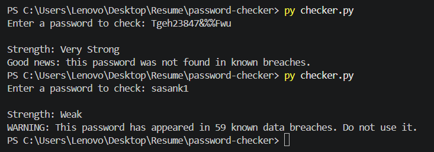

# Password Breach & Strength Checker

Checks whether a password has appeared in known data breaches using the HaveIBeenPwned API, and rates its strength.

## How it works
- Hashes the password with SHA-1 and sends only the first 5 characters of the hash to the API (k-anonymity), so the real password is never transmitted in full
- Compares the remaining hash locally against the API's response
- Rates strength based on length, uppercase letters, digits, and special characters

## Usage
python checker.py

## Sample Output
